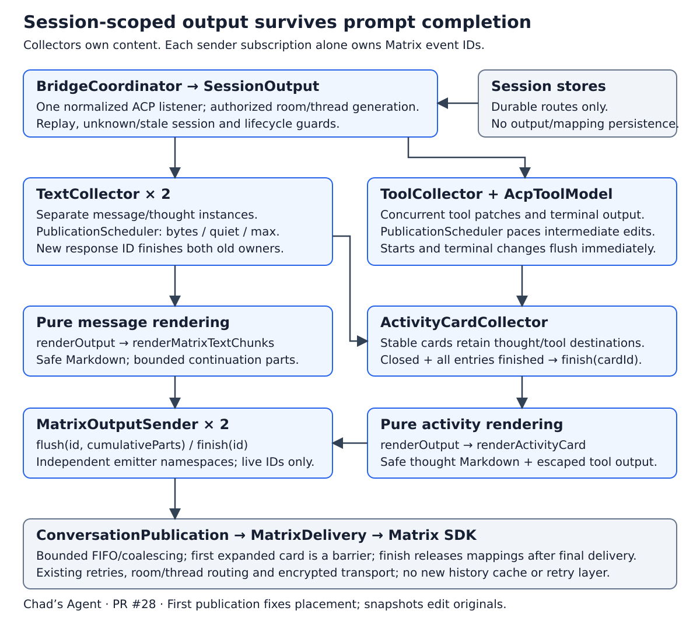
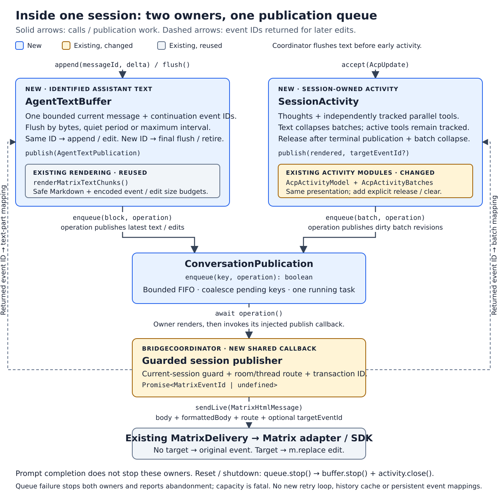

# Unified rendering: component map

Chad's Agent

Identified assistant messages, thoughts and tools share session lifetime, including
output received after prompt completion. The collector refactor in PR #28 implements
[collector-based output rendering](../specifications/collector-based-output-rendering.md).

## Overview

One normalized ACP listener in `BridgeCoordinator` applies authorization, live
session, loading/replay and lifecycle guards. It dispatches through
`SessionOutput.accept(update)` without requiring an active prompt. Session stores
preserve room/thread routes; rendered output and Matrix event mappings are ephemeral.

## Interfaces and data flow

1. `SessionOutput` dispatches to separate message/thought `TextCollector` instances
   and a concurrent `ToolCollector`. A genuinely new text response ID finishes both
   prior text owners. Switching text kind or receiving tool metadata does not.
2. `TextCollector.append(id, delta)` accumulates bounded UTF-8 text. Both instances
   use `PublicationScheduler`: byte threshold, quiet period and maximum interval
   share the existing configuration. `flush(id)` keeps an identity open;
   `finish(id)` flushes its remainder before forwarding finish. Repeated deltas append.
3. `ToolCollector` applies `AcpToolModel` field patches, result replacement and
   incremental terminal output. Starts/terminal changes flush immediately;
   intermediate changes, including status-only patches, share scheduler pacing.
   Terminal content precedes finish; active tools are independent of response IDs.
4. `ActivityCardCollector` replaces cumulative thought/tool entries, assigns stable
   card IDs and retains entry-to-card associations across rollover and collapse.
   The dispatcher reserves a thought entry before its first timed flush. This
   prevents premature retirement when text or tool completion arrives first.
   New cards first flush expanded. Collapse closes presentation to new entries;
   every contained entry must finish before the card emits finish.
5. `renderOutput` adapts exactly two operations: `flush(id, cumulativeContent)` and
   `finish(id)`. Messages use `renderMatrixTextChunks`. Pure `renderActivityCard`
   combines thought Markdown via `renderMatrixText`, escaped tool/code/diff output
   via `renderAcpActivity`, and application-authored disclosure wrappers. Full
   card wrappers and edit/thread envelopes are measured within event limits.
   Renderers preserve IDs and finish; they own no timers, mappings or retries.
6. Two `MatrixOutputSender` subscriptions bind independent emitter namespaces to
   the same authorized conversation/generation. Each alone retains live logical
   IDs and original Matrix IDs for continuation parts. New IDs do not evict other
   live IDs. Unchanged payloads skip edits; repacking clears surplus published
   parts without empty originals. The card subscription preserves the first flush
   as a separate queue barrier so collapse cannot erase the initial expanded view.
7. `ConversationPublication` bounds and serializes work. Pending snapshots coalesce
   by subscription/ID; finish stays behind final payload delivery and releases
   mappings afterwards. Each operation delivers one bounded snapshot, then yields
   to the queue. There is no content-drain loop bypassing collector pacing.
8. The bridge's generation-guarded callback adds routes, transaction IDs and
   accounting and calls `MatrixDelivery.sendLive`. Existing retries, SDK encryption
   and Matrix replacement envelopes remain the transport boundary.

## Lifetime and compatibility

Prompt completion does not flush or finish identified text. Nonempty assistant
text requests activity collapse independently of its own publication. Matrix
placement follows first publication; later snapshots edit those originals.

Final structured/rendered snapshots transfer into the bounded sender queue before
collectors release source state. Sender mappings survive queued/in-flight originals,
final edits and collapse. Reset, deletion, failure and shutdown stop the queue,
cancel timers, clear subscriptions and reject obsolete callbacks under the existing
abandonment policy. No historical/tombstone map or Matrix history reconstruction
is added. Restart preserves only durable routing and delivery bookkeeping.

Solicited ID-less assistant text keeps the legacy prompt path. Unsolicited ID-less
text emits one bounded diagnostic. A compatibility text collector groups ID-less
thoughts at message/tool boundaries without inventing ACP response identity.

The Pi adapter must supply stable sequential response IDs shared by thoughts and
text, including unsolicited output. Adapter implementation/validation remains a
separate prerequisite; scripted ACP and hermetic crypto results are distinguished
in the [current evidence](collector-rendering-verification.md).

Sources: [dispatcher](../src/session-output.ts), [text collector](../src/text-collector.ts),
[scheduler](../src/publication-scheduler.ts), [tool collector](../src/tool-collector.ts),
[cards](../src/activity-card-collector.ts), [renderers](../src/acp-activity-rendering.ts),
[sender](../src/matrix-output-sender.ts), [queue](../src/conversation-publication.ts).
SVGs are self-contained editable sources without external assets.
