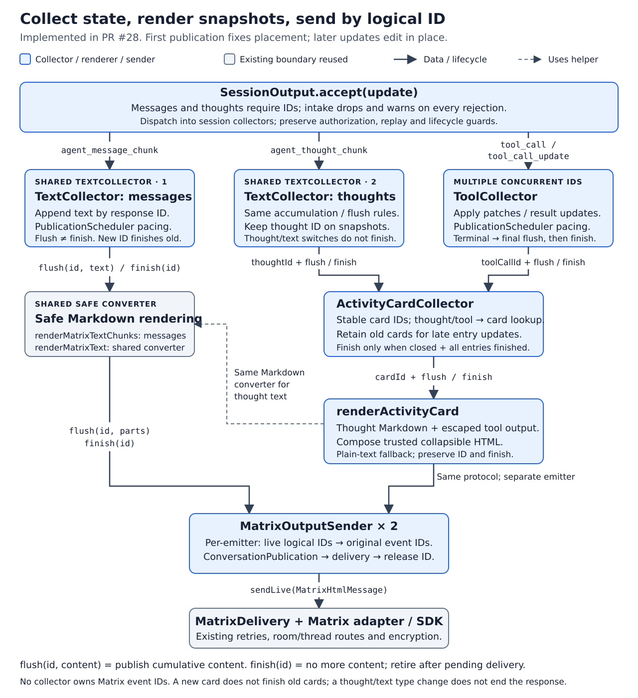

+++
status = "final"
created = 2026-10-17
last_update = 2026-10-17
+++

# Collector-based output rendering

## Purpose

Give streamed messages and thoughts the same accumulation and flush behavior,
keep tool/card state separate from presentation, and make the Matrix sender the
sole owner of logical-ID-to-Matrix-event mappings. This design is implemented on
the PR #28 feature branch.

Chad's Agent

## Context

This builds on [Unified message rendering](unified-message-rendering.md).
It replaces that design's collector-owned Matrix mappings and separate
text/activity publication machinery. It also relaxes strict ordering between
text and activity: Matrix placement follows first publication, with subsequent
snapshots editing the same events. Session routing, unsolicited output,
legacy thought/tool compatibility, encryption, failure policy and bounded retention remain required.

Pi can emit `thinking → text → thinking` within one assistant response. The
current pi-acp maps text and thinking deltas to the same response-scoped
`messageId`, without forwarding Pi's content-block indexes or end events.
Type changes therefore do not prove completion. Different assistant responses
remain sequential under the existing adapter contract.

## Goals

- Share text accumulation and publication scheduling between messages and thoughts.
- Accept interleaved thought, message and concurrent tool updates without losing identity.
- Preserve activity grouping, collapse, late tool updates and bounded resource use.
- Carry logical IDs through rendering; keep Matrix event IDs only in the sender.
- Separate progress publication from explicit identity retirement.

## Non-goals

- Implement pi-acp changes, add ACP lifecycle extensions, or require content-block IDs.
- Reconstruct exact cross-type chronology or move existing Matrix events.
- Change prompt execution, steering, authorization, routing or durable storage schemas.
- Add historical caches, Matrix-backed reconstruction or a second transport retry loop.
- Treat tool patches as append-only text or force every collector into one generic class.

## Design overview



The diagram describes the implementation. Collectors
hold domain state, renderers produce safe plain-text/HTML payloads, and the sender
owns publication identity. Each emitter subscription has its own ID namespace.

## Specification

### Dispatch and session scope

One ACP listener must dispatch normalized updates by type to session-scoped
message, thought and tool collectors. Existing session authorization, load/replay
filtering, extension-notification filtering and stale-generation guards remain
upstream of collection. No active prompt is required for mapped live output.

`SessionOutput.accept` is the type dispatcher; the bridge is the outer
session/lifecycle/routing guard. The canonical ACP client must reject every
normalized `agent_message_chunk` without a usable `messageId` before notifying
listeners, after intentional startup-prelude and extension-UI filtering. A usable
ID is a string containing at least one non-whitespace character; preserve valid
IDs verbatim. Missing, empty, whitespace-only and non-string IDs are rejected.
Each rejection emits `warn: agent-text-missing-id` with empty diagnostic fields;
never include text, raw payloads, IDs or credentials. Keep no warn-once, deduplication
or rate-limit state for this diagnostic.

The bridge must guard alternate clients/test doubles before dispatch as well.
Canonical-client rejections never reach that guard, so normal flow warns exactly
once per rejected chunk. The dispatcher must also ignore invalid assistant IDs
before any response transition, thought boundary, activity collapse or scheduling.
Rejected text must allocate no collector/timer/publication state, receive no
guessed ID, and never contaminate a valid stream. Legacy ID-less thoughts and tool
patches retain their existing handling.

Prompt outcomes contain only stop/error information, with no accumulated text.
Remove prompt-result text fallback, prompt-final assistant accumulation, ID-less
assistant-text collectors, drain quiet/cap timers and closed-message-ID history.
Successful prompt completion publishes no final text or empty placeholder, even
when no identified output arrived. Non-text error/timeout/stop statuses, typing,
cancellation, queueing and durable terminal bookkeeping remain independent from
collector publication.

Message and thought collectors must be separate instances of the same text
collector implementation. The same response ID can exist in both instances;
receiving the other text kind must not finish or clear either instance.

Under the current Pi adapter's shared response-ID contract, the dispatcher must
finish both collectors' prior-response text when a different response ID appears
on either text kind. Receiving a tool update is not evidence of response
completion. Do not infer assistant-response completion from a tool's `messageId`.

### Shared text collection and flush rules

A text collector must append deltas to its current logical ID and emit cumulative
snapshots carrying that ID, not resend deltas as snapshots. Repeated identical
deltas still append. A new response ID finishes the previous response as above.
Snapshots may continue for an ID after earlier progress was flushed.

Both text collectors must use the same scheduler and the existing
`agent_text_flush_bytes`, `agent_text_quiet_ms` and
`agent_text_max_interval_ms` values, defaults, bounds and UTF-8 byte semantics.
These settings govern thought text as well as assistant text in this design.
Do not add another set of timing knobs or silently rename existing keys.

A dirty collector must request publication on:

- New unpublished text reaching the byte threshold, subject to existing pacing.
- The quiet period expiring after its latest delta, even if no further input arrives.
- The maximum interval expiring from its first unpublished delta, even during continuous output.
- An explicit `flush(id)` or `finish(id)`, including an ID transition.

Here the timeout means the maximum publication interval, not a turn deadline or
proof that the text ended. A collector's `flush(id)` emits that ID's cumulative
content and keeps the identity open. Its `finish(id)` first flushes any remainder,
then emits the finish indication and closes that identity. Neither quiet periods, prompt completion
nor switching between thought and message output may finish an identified response.
Whitespace within an existing thought must remain part of its accumulated text.

No cross-type flush is required solely to reproduce ACP arrival order. The first
successful publication establishes each Matrix event's position; edits remain at
that position. ID transitions within a text emitter must still order the old
identity's final publication before the next identity's first publication.

### Tool collection

The tool collector must track multiple concurrent `toolCallId` values. It must
apply the existing field-specific semantics: status/title/input patches, result
replacement and incremental terminal output are not one append-only string.
`completed` and `failed` are terminal; changing IDs or finishing an assistant
response is not tool completion.

The tool collector must emit ID-bearing cumulative tool snapshots and an explicit
terminal indication to the activity-card collector. Tool starts and terminal
changes must request immediate publication; streamed intermediate changes should
use the shared scheduler's pacing/coalescing machinery. Status-only changes must
be marked dirty even when they add no text bytes. A terminal snapshot must be
forwarded before its end indication; buffered results must not be lost at completion.

### Activity-card collection and lifetime

The activity-card collector must accept thought snapshots keyed by thought ID
and tool snapshots keyed by tool-call ID, plus their finish indications. These
are distinct entry kinds even if the raw ID strings match. Repeated snapshots
replace that entry's accumulated content rather than append the snapshot again.

Assign a stable generated ID to each card. Retain the thought/tool-to-card
associations so updates modify the original entry/card rather than migrate to the
newest card. Preserve existing event-count/byte batching, thought normalization,
tool formatting, rollover and expanded/collapsed presentation.

Card composition must not add another independent debounce layer: flushed
collector snapshots update the card and request its publication. Ordinary pending
card edits may coalesce. Each new card must first publish expanded; a subsequent
collapse must not erase that required first view. Nonempty assistant text must
still request collapse of existing activity cards, without ending active tools
or thoughts and without forcing assistant-text publication first.

A card is eligible to finish only when:

1. It is closed to new entries and its final presentation is determined.
2. All contained tools have received their terminal indication.
3. All contained thoughts are finished, so no later buffered thought snapshot can arrive.
4. Its final content/status and required collapse have been emitted before `finish(cardId)`.

Rollover/collapse alone must not finish a card containing unfinished entries.
If thinking resumes after text within the same response, it updates that
response's existing thought entry, even in a collapsed/older card. A new response
ID closes the prior thought collector as defined above; this prevents its final
buffered delta from racing card retirement. A completed tool in the current open
card may remain retained until the card's presentation closes.

### Rendering: shared Markdown, separate card composition

Collectors must emit structured snapshots, not HTML or Matrix event IDs.

Assistant-message snapshots must pass through the existing safe Markdown renderer.
Thought text must use the same safe Markdown converter, called by the activity
renderer when composing a card. Preserve the thought paragraph markers and
heading normalization; other thought Markdown is interpreted through the shared
converter rather than treated entirely as literal text. This is an intentional
extension of thought formatting, not a replacement of the card's presentation.

The activity renderer, not the stateful card collector, must compose the full
card's plain-text body and HTML. It must combine safe thought fragments, existing
escaped tool/code/diff formatting, and application-authored `<details>`/`<summary>`
wrappers. Do not run the complete HTML card back through Markdown, allow ACP
content to supply trusted wrappers, or interpret arbitrary tool output as Markdown.

Renderers must preserve IDs and forward finish indications unchanged. They must
own no publication timers, transport retries or Matrix event mappings. Their
payload is an ordered, bounded list of plain-text/safe-HTML parts; splitting and
measurement must include the final card wrappers and Matrix edit/thread envelope.
Output caps and explicit truncation remain enforced. Empty unchanged content must
not produce duplicate edits or empty placeholder originals.

### Emitter protocol and Matrix sender

Each rendered-output emitter must expose an ordered stream with these conceptual
records; concrete type/function names are implementation choices:

```text
flush(id, renderedParts)  # cumulative latest content; keep this identity open
finish(id)               # no further content for this ID on this emitter
```

These are the only two downstream operations. A snapshot describes the cumulative
payload of `flush`, not an additional method. Collectors attach their accumulated
content when emitting a flush; renderers preserve the operation and ID while
converting its payload. The sender receives rendered content, not a bare request
to flush state it does not own. On receiving finish, it drains prior flushes and
releases the mapping; it does not reconstruct or accumulate content.

The Matrix sender must scope mappings to each emitter subscription, not a global
raw-ID map or a required message/thought discriminator. The subscription binds the
authorized room/thread and live session generation. Equal IDs on different
emitters must remain isolated. The message emitter normally has one current ID;
the card emitter can have multiple IDs still live because older tools/thoughts
can receive updates.

For each live ID the sender must retain the Matrix original event ID for each
continuation part. First publication sends originals; later snapshots edit those
originals, not the event IDs of previous replacement events. Continuation
repacking must reuse mappings and clear surplus published parts without creating
empty originals, as in the existing renderer.

A new ID may rotate a producer's current identity, but the sender must not infer
that every preceding ID is finished. In particular, a newer card does not retire
an older card awaiting tool completion. The producer explicitly emits `finish`
when it knows the ID is closed.

`finish(id)` must be ordered after that ID's final snapshot and any required
expanded/collapse publication. The sender must release its mapping only after
those sends/edits finish successfully or an explicit delivery failure is handled.
Finish is not itself a Matrix event. It must not be coalesced away, overtake a
final snapshot, or free the mapping while a send is in flight. An emitter must
not reuse an ID after finishing it during that subscription's lifetime; enforcing
this must not require an unbounded tombstone/history set.

Use the existing bounded per-conversation publication queue and MatrixDelivery
retry/serialization policy. Pending snapshots may coalesce by emitter and ID,
but must preserve identity order and required presentation transitions. Scheduling
must not hold the ACP listener waiting for network delivery or let one collector's
unbounded drain loop bypass pacing and starve other output.

### Resource, failure and restart behavior

Collectors retain bounded current text, unfinished tools and cards still eligible
for updates. Sender mappings exist only for live/queued/in-flight output; they are
not a history cache. Retain state through final delivery or transfer ownership of
final payloads into the bounded queue before releasing source data. Apply existing
session/activity/output/queue limits and observable backpressure; capacity failure
must not masquerade as successful output.

Reset, deletion, fatal connection failure and shutdown must cancel timers, stop
subscriptions and reject obsolete callbacks. Dispose of unfinished output under
the existing abandonment policy, not as successful `finish`. Release collector
and sender state after cleanup; previously sent Matrix events remain untouched.
Diagnostics must exclude private text, tool arguments/results and credentials.

Restart preserves only existing durable routing. Do not persist output snapshots,
card IDs or Matrix event mappings, fetch history to rebuild them, or replay loaded
history as live output. New live chunks may start fresh Matrix events. Preserve
eager rejection of all ID-less assistant text, whether solicited or unsolicited;
preserve existing ID-less thought grouping at legacy boundaries rather than
inventing stable ACP identity. Rejected assistant text must not close that thought
group or collapse its activity card.

## Verification

- Message/thought instances pass the same deterministic-clock tests: byte, quiet,
  maximum interval, explicit flush, ID transition, pacing, trailing text and cancellation.
- Both emit cumulative snapshots; repeated deltas append, repeated snapshots
  replace. Thoughts produce paced edits rather than an edit per streamed chunk.
- `thought(A) → text(A) → thought(A)` preserves both accumulations and updates the
  original destinations. A subsequent response ID finishes both old text owners.
- Prompt completion leaves both collectors live, with no duplicate final reply.
- Invalid assistant IDs are rejected eagerly during and outside prompts. Each
  rejection warns without private content, listener forwarding, collector/timer
  state, thought/card transitions or guessed identity. Mixed streams publish only
  valid deltas once. Canonical intake plus the bridge emits no duplicate warnings.
- Multiple tools interleave independently; terminal output precedes the terminal
  indication and status-only changes remain observable.
- A card with a pending thought flush cannot finish early when its last tool ends.
- An old card continues updating after rollover; it finishes only after its last
  tool/thought and final collapse. Sender mappings then release, without historical growth.
- Equal IDs across emitter subscriptions stay isolated; generated card IDs remain
  stable across updates. A newer card does not discard older live mappings.
- First publication fixes placement; interleaved updates edit existing events
  without requiring strict cross-type event ordering or additional originals.
- Each card first appears expanded, even when immediate completion/collapse and
  slow delivery would otherwise coalesce that view away.
- Split Markdown in messages and thoughts stays safe. Thought markers/normalization,
  tool formatting, collapsible HTML and plain-text fallbacks remain readable.
  Untrusted raw HTML cannot escape into card wrappers.
- Slow/failing sends, finish during an in-flight original/edit, continuation
  growth/shrinkage and queue exhaustion preserve final payloads, ordering,
  bounded retention and explicit failure reporting.
- Reset/shutdown/loading replay and restart leave no timers, mappings, accidental
  cross-session sends, history reads, crypto resets or duplicate output.
- Integration tests cover room/thread isolation and the existing encrypted delivery
  boundary; real Matrix results must remain distinguished from crypto/HTTP fixtures.

## Compatibility and rationale

This supersedes the earlier design for collection, publication identity,
thought Markdown/pacing, cross-type ordering and assistant-text compatibility.
The approved eager-rejection decision replaces all prior solicited ID-less text
fallback and unsolicited warn-once behavior. Only legacy thought/tool compatibility
remains. Safe output limits, non-text prompt/error behavior, thread/encryption
policy and activity layout remain. There is no stored-state migration or
configuration rename.

Sharing text collection and flush scheduling is required; a universal collector
for text, tool patches and card layout is not. Pure rendering helpers should be
reused without moving card state into renderers or Matrix identity back into
collectors. Explicit finish makes bounded sender retirement possible without
guessing from unrelated output.

## References

- [Unified message rendering](unified-message-rendering.md)
- [Existing activity presentation](verbose-acp-output.md)
