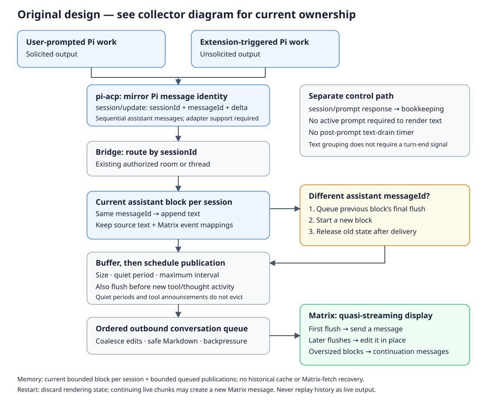

+++
status = "final"
created = 2026-10-16
last_update = 2026-10-17
+++

# Unified solicited and unsolicited message rendering

This records the first PR #28 design. Its collection, mapping ownership, thought
formatting/timing and strict text-before-activity rules are superseded by
[Collector-based output rendering](collector-based-output-rendering.md).
The diagram below illustrates that original design; use the
[collector diagram](collector-based-output-rendering.svg) for the current implementation.
Routing, compatibility, delivery and resource requirements still apply.

## Purpose

Display agent messages in Matrix through one session-scoped rendering path, whether a user prompt or an extension initiated the agent's work. Buffer streamed chunks to limit Matrix calls without waiting for a prompt response to deliver text.

## Context

Before PR #28, the bridge collected output within an active prompt. An extension can trigger an unsolicited turn after that prompt completes; its text still arrives through ACP `session/update`, but no active prompt collector exists to display it.

This specification replaces the agent-text portion of **Eager Message Rendering** in [Verbose ACP output](verbose-acp-output.md): identified messages may be sent incrementally and edited rather than sent only once at inferred completion. Existing thought/tool presentation remains unchanged unless needed to preserve routing and ordering.

## Design overview

Both sources deliver the same identified text chunks. The bridge routes by session, appends to the current message block, and buffers publication through an ordered conversation queue. The first flush sends a Matrix message; later flushes edit it in place. A different assistant message ID retires the previous block after delivery. Prompt completion remains separate from rendering.

## Goals

- Display solicited and unsolicited assistant text and tool activity through the same session-scoped renderer.
- Group chunks by message identity rather than prompt lifetime.
- Deliver trailing text without requiring a subsequent message or prompt response.
- Bound buffering and Matrix traffic while preserving conversation isolation.

## Non-goals

- Implement message IDs in pi-acp; that is a separate prerequisite.
- Add ACP message-end or unsolicited-turn lifecycle extensions.
- Infer authoritative message or turn completion from silence.
- Change prompt submission, steering, cancellation, or agent execution scheduling.
- Redesign thought/tool rendering or provide durable, exactly-once stream replay.

## Specification

### Adapter prerequisite

Assume pi-acp supplies ACP's optional `messageId` on every assistant text chunk, including unsolicited output. Implementing and validating that support belongs in a separate pi-acp change.

All chunks of one logical assistant message must share an ID; distinct messages must have distinct IDs within a session. Chunks are ordered text deltas, not replacement snapshots. IDs must remain unambiguous for as long as a session can continue delivering updates, including after restoration.

Assume assistant messages are sequential and non-interleaved: once text for a different assistant message ID arrives, the previous message receives no further text. pi-acp must mirror Pi's message boundaries rather than inventing boundaries at thoughts or tool announcements. This assumption follows Pi's agent loop: it awaits `streamAssistantResponse()`, which emits `message_end`, before executing tools or starting another assistant response. `Agent.prompt()` and `continue()` reject concurrent runs; steering and follow-ups are queued. This is a Pi/adapter contract, not a guarantee implied by ACP's optional message ID alone.

An ACP `tool_call` is not proof of assistant-message completion: pi-acp announces tools while their arguments are still streaming within that assistant message. More text for the same message may follow the announcement.

`session/update` is a JSON-RPC notification: it carries `sessionId`, but no JSON-RPC request ID. The renderer must not require an outstanding `session/prompt` or its response to accept text.

### Session routing

The bridge must resolve each update's session ID to its existing authorized Matrix conversation. Room mode sends into that room; thread mode sends into that conversation's existing thread. An unsolicited message must not be attached to whichever user prompt happens to be active.

Unknown, reset, deleted, or superseded sessions must not create conversations or send output. History replay during session loading must not be mistaken for new live output. Existing authorization, encryption, notification filtering, and safe-rendering rules continue to apply.

### Message blocks

Maintain logical blocks keyed by `(sessionId, messageId)`:

- A new ID creates a block in first-seen order.
- A chunk for the current ID appends to that block, including after a flush, quiet period, thought, or tool announcement.
- A different assistant message ID retires the previous block: flush it, finish its queued publication, then release its text and Matrix-event mapping.
- The first flush sends a Matrix message. Later flushes update the same block using Matrix replacement events.
- An unchanged block must not produce another Matrix call. Do not send empty placeholder messages.
- Repeated message IDs identify the destination block; they do not make repeated chunks duplicates. No chunk-level replay detection is implied.

Message identity and delivery state belong to the session, not a prompt collector. A prompt response must not discard blocks, resend their text as a final reply, or prevent later chunks from being displayed. Existing prompt error/status reporting remains separate; a successful prompt whose text was already displayed must not generate an empty-response fallback solely because its collector owns no text.

### Buffered delivery

Each dirty block must flush when any of these conditions occurs:

1. Its buffered unsent text reaches the configured UTF-8 byte threshold.
2. Its quiet-period timer expires after the most recent chunk.
3. A different message ID arrives in the same session: schedule the previous block's buffered text before publishing the new block.

Continuous low-volume output must also flush within a configured maximum interval from the first unflushed chunk, so repeatedly resetting the quiet timer cannot postpone delivery indefinitely. Expose three publication controls under `[matrix]`:

| Setting                      | Default | Inclusive bounds |
| ---------------------------- | ------: | ---------------: |
| `agent_text_flush_bytes`     |   2,048 |       256–16,384 |
| `agent_text_quiet_ms`        |     750 |        100–5,000 |
| `agent_text_max_interval_ms` |   2,000 |       250–10,000 |

Require integer values and `agent_text_quiet_ms <= agent_text_max_interval_ms`. Count new unpublished UTF-8 bytes, not total block size. A message-ID transition is an unconditional flush trigger, not another configuration setting. Interval pacing and coalescing must prevent repeated size-threshold crossings from bypassing Matrix rate control.

Keep `max_output_bytes` and `max_matrix_message_bytes` as output/event-size limits, not publication triggers. Remove all prompt-scoped text draining, including `QUIET_DRAIN_MS` and `STREAMING_DRAIN_CAP_MS`. The quiet-period setting replaces the former text-drain timing role; there is no post-prompt drain deadline. Complete prompt bookkeeping when its ACP response arrives, independently of buffered text publication. These changes must not introduce another equivalent drain configuration.

A quiet timer must fire without another incoming update. A quiet-period, size, interval, or activity flush does not finalize or evict the current block: later chunks with the same ID continue updating it. A different assistant message ID closes the previous block under the non-interleaving contract. Neither silence nor a message-ID transition asserts that an unsolicited turn has ended.

Serialize Matrix operations per conversation and coalesce pending updates to their latest accumulated text. A slow send must not cause concurrent edits or stale edits to overwrite newer text. Flush triggers request delivery; they must not bypass existing transport limits or retry ownership.

### Session-scoped activity lifecycle

Move the activity model and its Matrix batch mappings out of prompt collectors and into session-scoped rendering state. Accept thoughts, `tool_call`, and `tool_call_update` notifications for any live mapped session, whether prompted or unsolicited. Prompt completion must not discard activity or suppress subsequent updates. Keep existing thought grouping and activity presentation; this changes ownership and lifecycle, not appearance.

Tool calls are keyed by `(sessionId, toolCallId)`, independently of assistant message IDs. pi-acp already maps Pi's `tool_execution_end` to a `session/update` containing `tool_call_update` with `status: completed` or `failed`, including when no ACP prompt is pending. No new adapter completion extension is required for tools.

Pi can execute tools in parallel. A different tool call or assistant message ID is not a tool-retirement signal. Retain each active tool until its terminal update has been published. Retain a containing activity batch while any tool is active or any final publication/collapse edit is pending. Once the batch is closed, all contained tools are terminal, and its final updates and collapse have been published, release its source state and Matrix-event mappings. Completed tools may remain temporarily in the current bounded batch for its existing presentation lifecycle; do not retain a historical tool index.

An assistant-message transition may retire the previous text block without discarding running tools or their batches. A background process outliving its start tool does not keep that tool active: the start tool completes normally; subsequent process notifications cause separate activity.

Bound active activity and queued publication using existing activity/output limits and backpressure. Session termination, reset, deletion, or transport failure must clean up tools that cannot receive a normal terminal update, preserving existing failure reporting without treating missing completion as success. Diagnostics must not contain private tool arguments or results.

### Thought and tool interleaving

Use one ordered outbound queue per conversation for text and activity. Preserve the existing activity presentation contract:

- A new `tool_call` or nonempty thought schedules preceding buffered assistant text before publishing the activity.
- A whitespace-only thought does not trigger a text flush.
- A `tool_call_update` updates its existing activity block without creating a text boundary.
- The first nonempty assistant chunk collapses live activity batches as before.
- A different assistant message ID schedules preceding buffered text before the new block is published.

Thought/tool activity triggers publication, not eviction. Text for the current assistant ID may continue after that activity and must edit the same block. Only a different assistant message ID retires it. Existing activity batching, initial expanded publication, disclosure, and tool-status rules remain unchanged. Preserve ordering through the outbound queue rather than blocking ACP intake on a Matrix request.

### Rendering and resource limits

Render accumulated Markdown through the existing safe converter on each publication. Preserve the original text in the plain-text body. Incomplete Markdown may render differently as later chunks arrive; never expose unsafe HTML while waiting for completion.

Apply existing encoded Matrix event-size and output limits. A logical block may span bounded continuation events; retain their association with the same message ID. Already-published parts must not be duplicated during splitting or edits. If content is truncated by an output limit, retain an explicit truncation marker.

Retain only the current assistant block per session: its bounded accumulated source text, timers, and Matrix-event mappings, including continuation parts. Keep it across quiet periods, prompt completion, and tool/thought announcements until a different assistant message ID arrives or the session is retired. No historical text cache, historical identity index, idle-eviction timer, or Matrix-backed text recovery is needed.

On an assistant message-ID transition, schedule the previous block's final flush before the new block's publication. Release its source text and mappings only after queued publication succeeds or an explicit delivery failure is handled. Pending publication may temporarily retain retired blocks, so bound the outbound queue and apply backpressure; a session limit alone does not bound queued sends. Coalesce pending edits without losing message boundaries.

Existing session-count limits, a per-logical-message application of `max_output_bytes`, encoded event limits, and bounded outbound operations constrain retained state. Continue consuming excess deltas without accumulating them beyond the output cap; preserve an explicit truncation marker. Do not add independent historical block-count, cache-byte, or identity-index capacity settings. Do not reintroduce such storage to support interleaved IDs outside the adapter contract.

### Failure and lifecycle handling

Keep existing Matrix delivery failure and backpressure policy. Diagnostics must not include private text or credentials. A timer or send callback from an obsolete session must not publish into its replacement.

On reset, deletion, disconnect, or shutdown, cancel timers and retire rendering state according to the existing lifecycle policy. Previously sent Matrix messages remain. Persist neither source text nor message mappings across restart; persisted room/thread routing remains intact. If live chunks for a previously published agent message arrive after restart, create a new Matrix block from the newly received text. This continuation may use a new Matrix event even though the ACP message ID is unchanged; reconstructing its pre-restart prefix is not required. A restart must not replay session history as new unsolicited output. Any unrecoverable buffered delivery must be observable rather than reported as successful.

### Compatibility

For messages with IDs, the new path is the sole owner of assistant-text publication. It must not coexist with a second prompt-final renderer that duplicates output.

ACP permits missing message IDs, but this bridge requires a nonempty, non-whitespace
string ID for every assistant-message chunk. Eagerly reject any chunk without one,
during or outside a prompt, and warn on every rejection without text, raw payloads,
IDs or credentials. Do not retain warning deduplication state, infer an ID, collect
rejected text or merge it into an identified block. The canonical client rejects
before listener dispatch after startup/UI filtering; the bridge guards alternate
clients without duplicate normal warnings. `SessionOutput.accept` remains the type
dispatcher and rejects invalid assistant IDs before collector/card changes.

This decision supersedes the earlier solicited ID-less compatibility path and
unsolicited warn-once policy. Prompt outcomes carry no text and the bridge has no
prompt-final fallback, text drain timers or closed-ID history. Successful prompt
completion emits no assistant-text or empty-response copy. Legacy ID-less thoughts,
tool patches and non-text error/timeout/stop responses retain their own contracts.

Do not persist rendering state or change the stored conversation schema. A new Matrix block for a continuing agent message after restart is accepted behavior. Adapters that interleave assistant message IDs are outside this feature's contract; supporting them would require a separate design.

## Verification

- An unsolicited message received after a prompt completes is displayed in its mapped room/thread without any new prompt request or response.
- Solicited and unsolicited chunks with the same identity follow identical append, buffering, send, and edit behavior.
- Repeated IDs append to one block; distinct IDs create separate blocks. The same ID in two sessions remains isolated.
- A quiet period flushes the last chunk without further input. A later chunk updates that block rather than duplicating it.
- A message-ID transition flushes preceding text before the new block is published, then releases the previous block's text and mappings after delivery. Interleaved assistant IDs are not supported.
- Size and maximum-interval triggers deliver continuously streamed text; deterministic-clock tests verify bounded call counts and timer cleanup.
- Slow Matrix requests coalesce edits, preserve ordering, and cannot overwrite newer content with stale snapshots.
- Prompt completion produces neither duplicate text nor a spurious empty response after streamed publication. It does not wait for text-drain silence or a 30-second cap; later chunks remain displayable.
- Only the current assistant block is retained per session, apart from bounded queued/in-flight publication. Quiet periods, prompt completion, thoughts, and early tool announcements do not evict it.
- Text arriving after a streamed tool announcement with the same assistant ID edits the same block. Test this separately from an actual assistant message-ID transition.
- Many sequential messages release prior blocks and mappings without historical growth, Matrix reads, or cache/index capacity settings. Slow and failed sends exercise bounded backpressure and observable delivery failure.
- Restart discards mappings. New live chunks for an earlier ACP message create a new Matrix block from those chunks, without history replay or reconstruction of the previous prefix.
- Text is queued before new tool/thought activity; whitespace-only thoughts and tool updates do not flush text. Existing activity expansion/collapse rules remain intact.
- Verify the adapter prerequisite against Pi: each assistant response ends before the next starts, and pi-acp assigns one stable ID per response, including text surrounding tool announcements.
- An unsolicited tool call receives the same batch rendering and status/result edits as a prompted call, including its forwarded `completed` or `failed` update without a pending prompt.
- Parallel tools remain independently tracked; starting another tool, receiving a new assistant ID, or completing an ACP prompt does not retire a running tool.
- A closed batch releases its tool state and Matrix mappings only after every tool is terminal and final updates/collapse are published. Sequential batches do not accumulate a historical index.
- Reset, subprocess exit, and transport failure retire incomplete activity through explicit failure/cleanup behavior, without orphan mappings or false successful completion.
- Markdown split across chunks renders safely throughout; long messages respect encoded size limits and preserve text up to explicit output caps.
- Unknown/stale sessions and loading-history updates publish nothing. Reset, shutdown, output limits, and delivery failures leave no orphan timers or cross-session sends.
- Every solicited/unsolicited ID-less assistant chunk is dropped eagerly with a
  content-free warning. Mixed valid/rejected streams preserve only identified text;
  rejected chunks allocate no collector/timer state or alter thoughts/tools.
  Prompt outcomes contain no text and normal client/bridge flow warns once per rejection.

## References

- [ACP prompt turns](https://agentclientprotocol.com/protocol/prompt-turn)
- [ACP schema](https://github.com/agentclientprotocol/agent-client-protocol/blob/main/schema/schema.json): `ContentChunk.messageId`.
- [Thread-scoped agent sessions](thread-scoped-agent-sessions.md)
